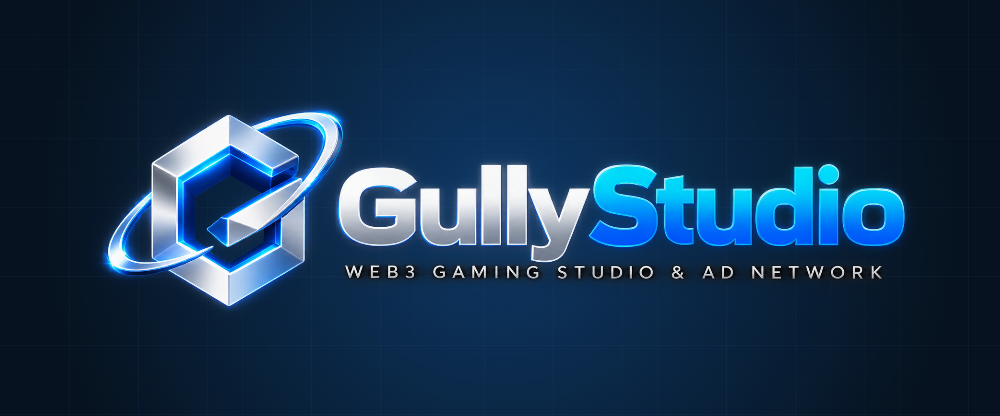

<!-- gully-header:start -->

  <a href="https://gullystudio.xyz">
    <picture>
      <source media="(prefers-color-scheme: dark)" srcset=".github/assets/gullystudio-logo-transparent.png">
      
    </picture>
  </a>

<b>Web3 Gaming Studio &amp; Ad Network. Unity 3D games on Gully Chain.</b>

GitHub Action that builds Gully Studio Unity games in CI.

  
  
  
  

A Gully Studio fork of <a href="https://github.com/game-ci/unity-builder">game-ci/unity-builder</a>, maintained by <a href="https://gullylabs.xyz">Gully Labs</a>. It is used under its MIT licence; the upstream LICENSE, copyright and attribution notices are kept unchanged. The upstream README follows below as published. Not affiliated with or endorsed by game-ci.

---
<!-- gully-header:end -->

# Unity - Builder

(Not affiliated with Unity Technologies)

GitHub Action to
[build Unity projects](https://github.com/marketplace/actions/unity-builder)
for different platforms.

Part of the <a href="https://game.ci">GameCI</a> open source project.
 
 

 
 

## How to use

Find the
[docs](https://game.ci/docs/github/builder)
on the GameCI
[documentation website](https://game.ci/docs).

## Related actions

Visit the
GameCI <a href="https://github.com/game-ci/unity-actions">Unity Actions</a>
status repository for related Actions.

## Community

Feel free to join us on

and engage with the community.

## Contributing

To help improve the documentation, please find the docs [repository](https://github.com/game-ci/documentation).

To contribute to Unity Builder, kindly read the [contribution guide](./CONTRIBUTING.md).

## Support us

GameCI is free for everyone forever.

You can support us at [OpenCollective](https://opencollective.com/game-ci).

## Licence

This repository is [MIT](./LICENSE) licensed.

This includes all contributions from the community.

<!-- gully-footer:start -->
---

  <a href="https://gullylabs.xyz">
    <picture>
      <source media="(prefers-color-scheme: dark)" srcset=".github/assets/powered-by-gully-labs-dark-2x.png">
      
    </picture>
  </a>

<!-- gully-footer:end -->
